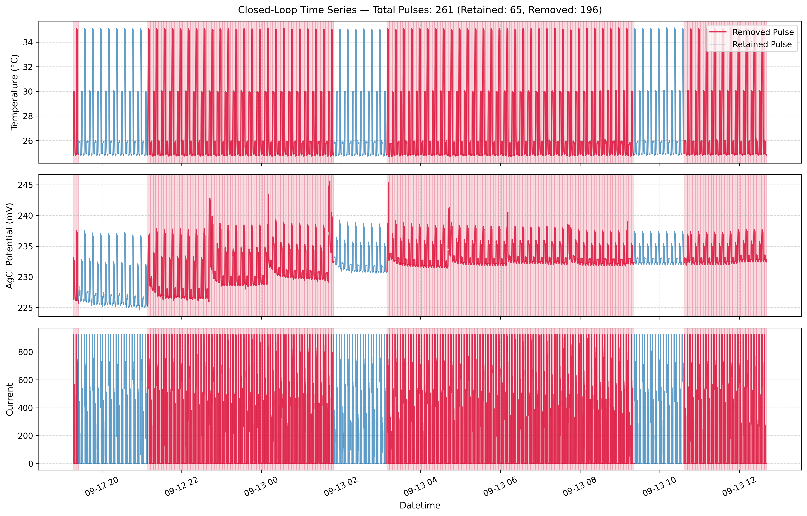
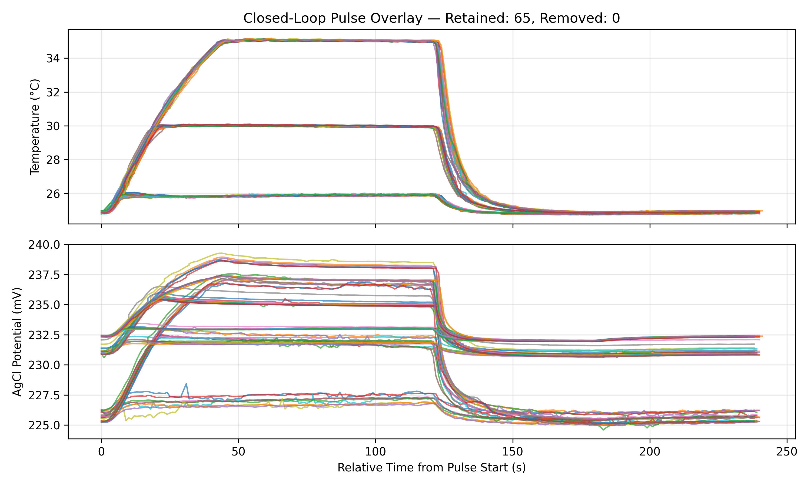
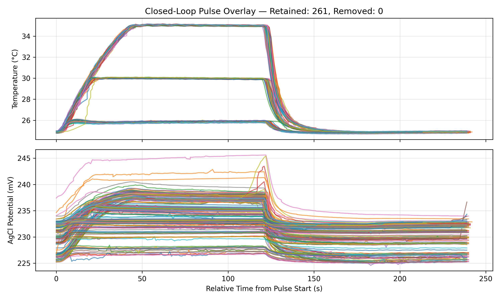

# Figure 2. Open vs Closed Loop Pulses

## Data Process
Plotting of time series for experimental overview (plotTimeSeries.py)

Raw data files with distinct headers parsed to JSON pulse structure with unified properties

Compare open vs closed loop pulses (CP and T pulses)
- power
- reproducibility
- temperature repeatability

# Macro Selection and Parsing of Pulses (closedPulseParse.py)
Raw serial text data (closed_loop_titration.txt) is parsed into a pulse data structure and saved ina JSON file format. Macro-selection allows for some high level selection of the dataset.

## Time Series of Exp.

# Parsing and Filtering Pulses
## Parsed Pulses

  
  

