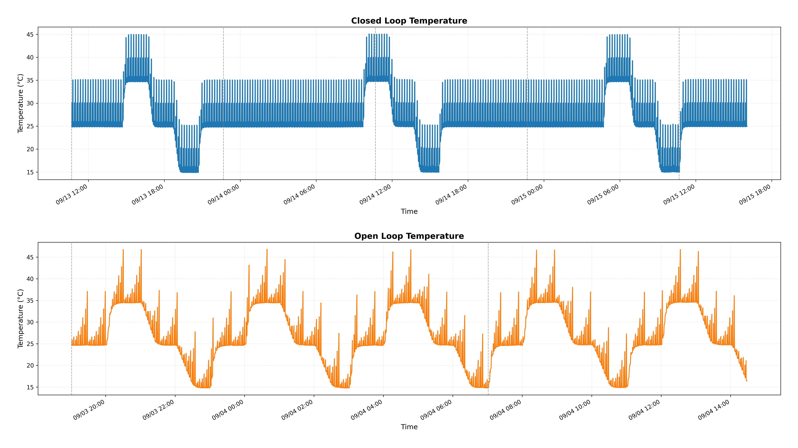
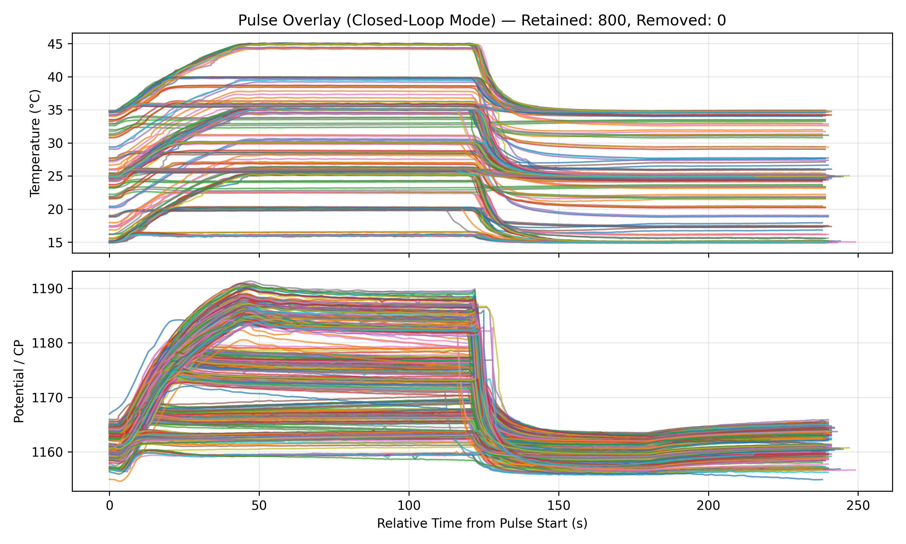
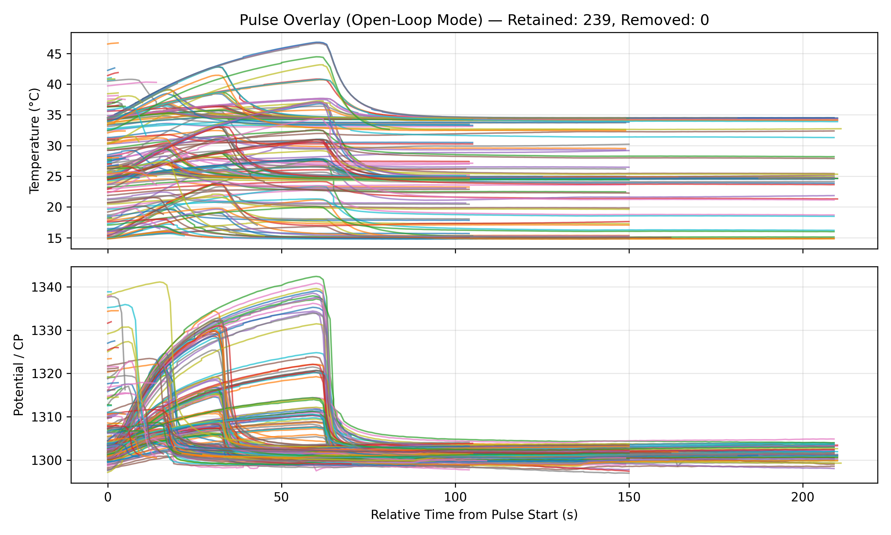
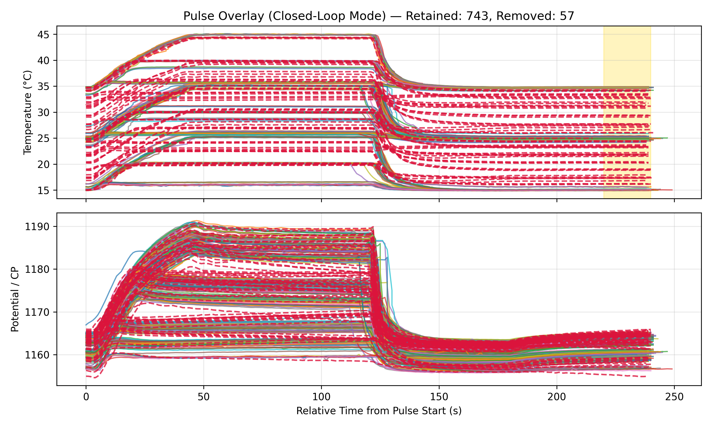
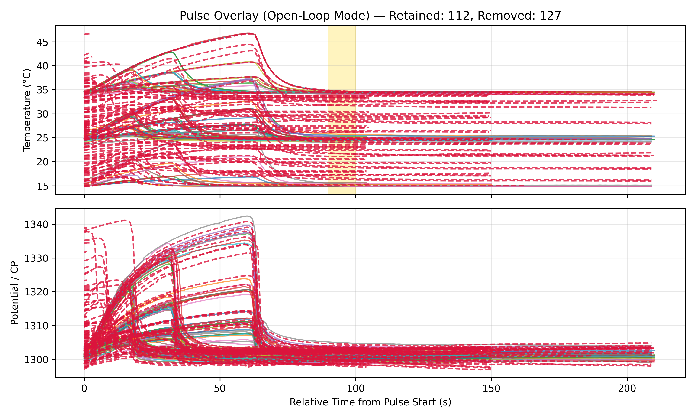
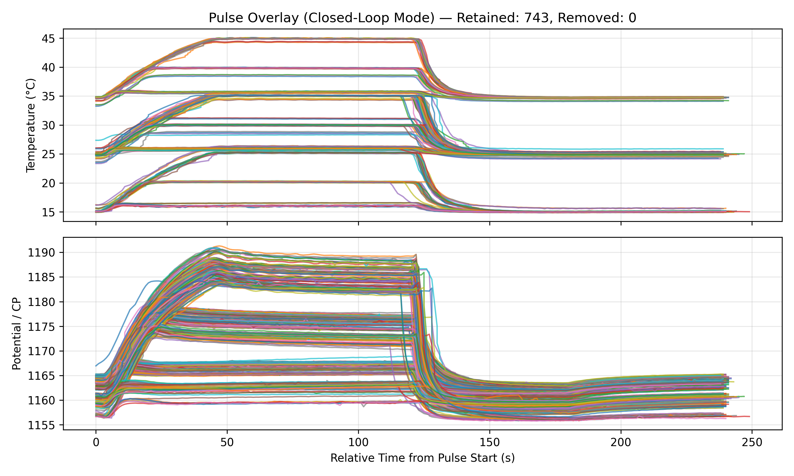
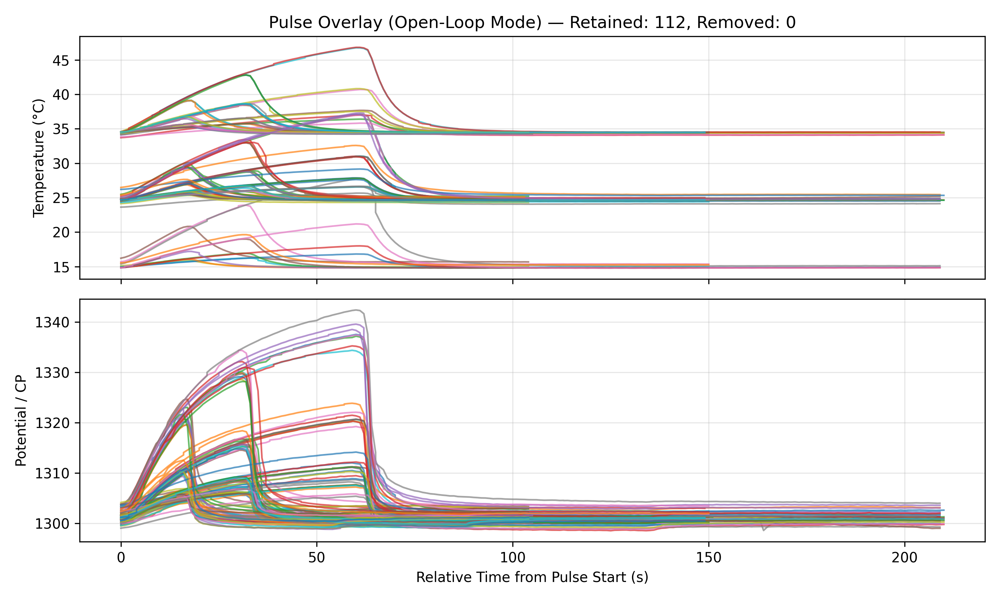

# Figure 2. Open vs Closed Loop Pulses

## Table of Contents
- [Data Process](#Data-Process)
- [Time Series of Exp.](#Time-Series-of-Exp.)

## Data Process
Plotting of time series for experimental overview (plotTimeSeries.py)

Raw data files with distinct headers parsed to JSON pulse structure with unified properties

Compare open vs closed loop pulses (CP and T pulses)
- power
- reproducibility
- temperature repeatability

## Time Series of Exp.
Open and closed loop pulses were evaluated in independent experiments. Closed loop exp. ran for a duration of ~48hrs and open loop ~17hrs. 

## Parsed Pulses

  
  

## Removed Pulses
removed pulses that were shorter than defined on off duration and where the measured temperature deviated from the temperature setpoint.

  
  

## Remaining Pulses

  
  

