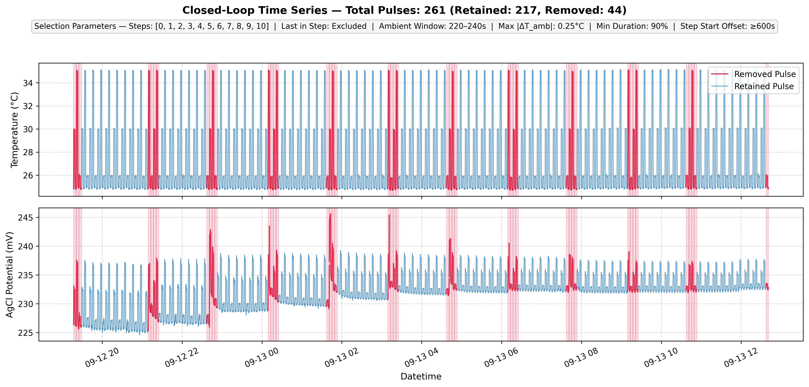
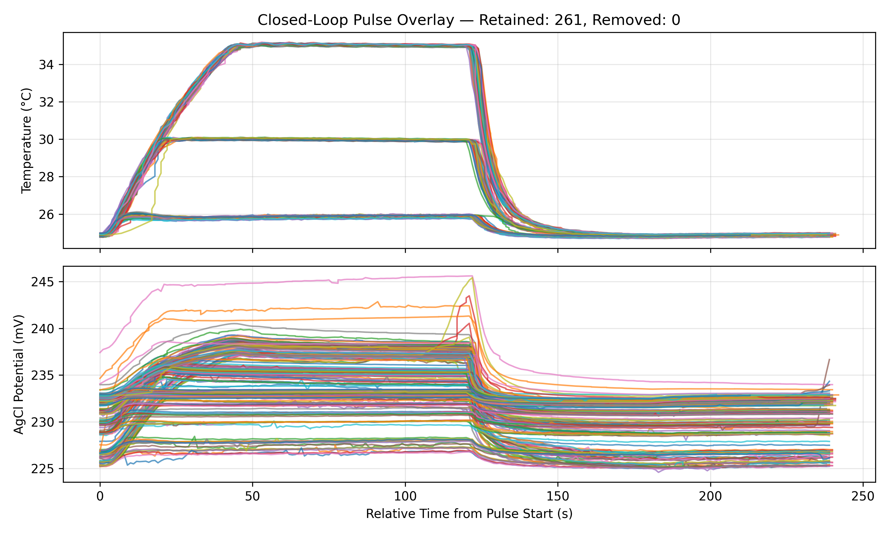
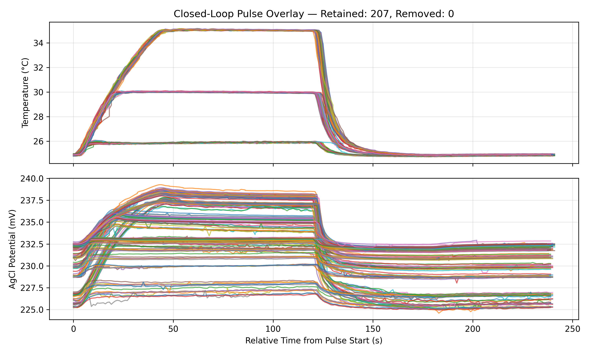
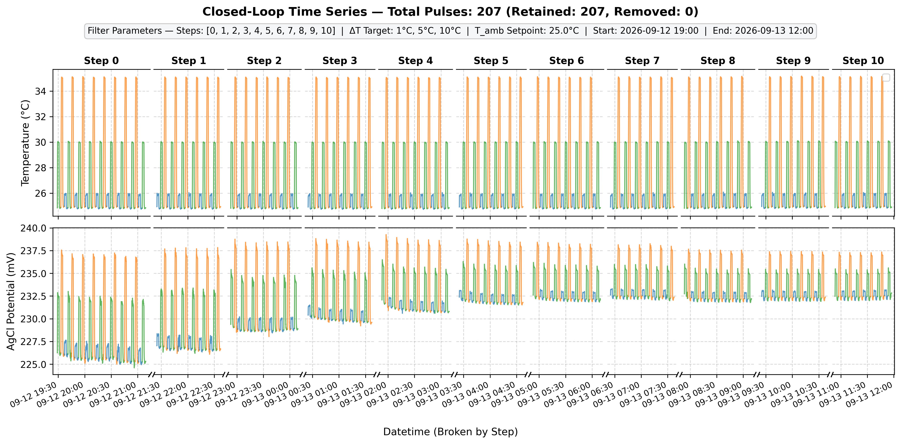
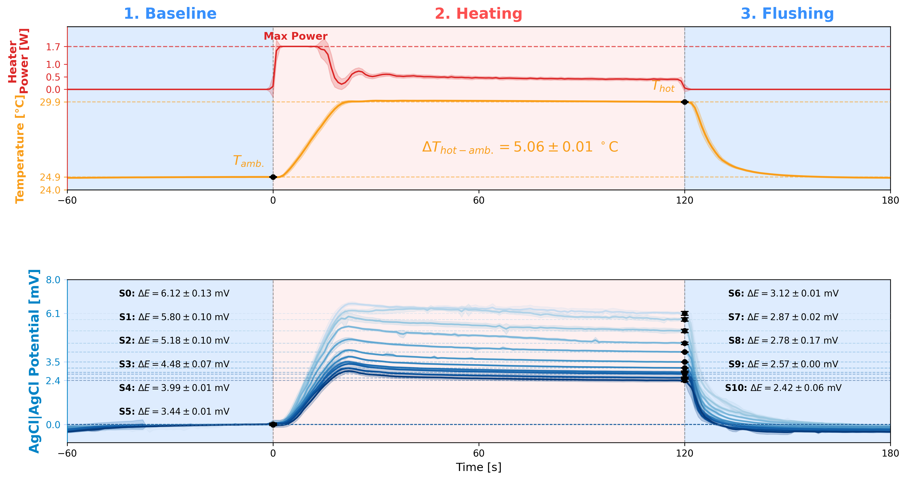

# Figure 3. Chloride Response

## Macro Selection and Parsing of Pulses (closedPulseParse.py)
Raw serial text data (closed_loop_titration.txt) is parsed into a pulse data structure and saved ina JSON file format. Macro-selection allows for some high level selection of the dataset.

### Time Series of Exp.

### Parsed Pulses

  
  

## Pulse Filtering (closedPulseSelect.py)

### Time Series of Exp.

### Filtered Pulses

## Calculating Delta (pulseCalc.py)

  
  
  

### Chloride Ion Activity ($a_{\text{Cl}^-}$) Calculation

Because experimental chloride concentrations span $0.01\text{ M}$ to $0.70\text{ M}$—well beyond the dilute regime of the classical Debye–Hückel limiting law ($I \le 0.01\text{ M}$)—single-ion chloride activity ($a_{\text{Cl}^-}$) and $\log_{10}(a_{\text{Cl}^-})$ are computed in `pulseCalc.py` using the **Davies Equation**.

#### Governing Equations

1. **Ionic Strength ($I$):**
   $$I = \frac{1}{2} \sum_{i} c_i z_i^2$$
   For a completely dissociated 1:1 strong chloride electrolyte ($z_+ = +1$, $z_- = -1$), ionic strength simplifies to the molar concentration:
   $$I = c_{\text{Cl}^-}$$

2. **Davies Equation for Single-Ion Activity Coefficient ($\gamma_{\text{Cl}^-}$):**

$$
\LARGE \log_{10}(\gamma_{\text{Cl}^-}) = -A(T)\, z_{\text{Cl}^-}^2 \left( \frac{\sqrt{I}}{1 + \sqrt{I}} - b\, I \right)
$$

3. **Temperature-Dependent Debye–Hückel Parameter ($A(T)$):**
   $$A(T) = 1.824829 \times 10^6 \, \left(\varepsilon_r(T) \cdot T\right)^{-3/2}$$
   where the static relative permittivity of pure water $\varepsilon_r(T)$ is evaluated from the Malmberg–Maryott empirical polynomial ($T_C$ in $^\circ\text{C}$, $T = T_C + 273.15\text{ K}$):
   $$\varepsilon_r(T_C) = 87.740 - 0.40008\,T_C + 9.398 \times 10^{-4}\,T_C^2 - 1.410 \times 10^{-6}\,T_C^3$$

4. **Single-Ion Activity ($a_{\text{Cl}^-}$) & Log Activity:**
   $$a_{\text{Cl}^-} = \gamma_{\text{Cl}^-} \left(\frac{c_{\text{Cl}^-}}{c^\circ}\right), \qquad \log_{10}(a_{\text{Cl}^-}) = \log_{10}(\gamma_{\text{Cl}^-}) + \log_{10}(c_{\text{Cl}^-})$$

#### Variable & Constant Definitions

| Symbol | Property in JSON | Value / Units | Description |
| :--- | :--- | :--- | :--- |
| $c_{\text{Cl}^-}$ | `concentration_m` | $\text{mol}\cdot\text{L}^{-1}$ ($\text{M}$) | Molar chloride concentration for each titration step. |
| $c^\circ$ | — | $1\text{ mol}\cdot\text{L}^{-1}$ | Standard-state reference concentration (makes activity dimensionless). |
| $I$ | `ionic_strength_m` | $\text{mol}\cdot\text{L}^{-1}$ ($\text{M}$) | Solution ionic strength ($I = c_{\text{Cl}^-}$ for a 1:1 electrolyte). |
| $z_{\text{Cl}^-}$ | — | $-1$ | Elementary charge number of the chloride ion ($z_{\text{Cl}^-}^2 = 1$). |
| $b$ | `davies_b_parameter` | $0.30\text{ L}\cdot\text{mol}^{-1}$ | Empirical Davies linear short-range interaction parameter. |
| $T_C, T$ | — | $^\circ\text{C}$, $\text{K}$ | Measured baseline ambient temperature (`temp_last_off`) per step. |
| $\varepsilon_r(T)$ | — | Dimensionless ($78.30$ at $25\,^\circ\text{C}$) | Static dielectric constant of pure water. |
| $A(T)$ | — | $\text{L}^{1/2}\cdot\text{mol}^{-1/2}$ ($0.5092$ at $25\,^\circ\text{C}$) | Debye–Hückel electrostatic limiting slope. |
| $\gamma_{\text{Cl}^-}$ | `activity_coefficient` | Dimensionless | Single-ion molar activity coefficient of $\text{Cl}^-$. |
| $a_{\text{Cl}^-}$ | `activity` | Dimensionless | Effective thermodynamic activity of $\text{Cl}^-$. |
| $\log_{10}(a_{\text{Cl}^-})$ | `log_activity` | Dimensionless | Base-10 logarithm of chloride ion activity. |

#### Key Assumptions
1. **Complete Dissociation (1:1 Strong Electrolyte):** The chloride salt is assumed to dissociate 100% in aqueous solution with no significant ion-pair formation across $0.01\text{–}0.70\text{ M}$, yielding $I = c_{\text{Cl}^-}$.
2. **Molarity vs. Molality Equivalence:** Standard Davies constants use molarity ($\text{mol}\cdot\text{L}^{-1}$) directly in place of molality ($\text{mol}\cdot\text{kg}^{-1}$), introducing $<1\%$ deviation in dilute-to-moderate aqueous solutions near $25\,^\circ\text{C}$.
3. **Isothermal Reference Baseline:** Activities are evaluated at each step's measured baseline ambient temperature (`temp_last_off`) prior to localized thermal pulsing, matching the Nernstian reference condition before thermal perturbation ($\Delta T$).
4. **Pure-Water Dielectric Permittivity:** Solvent permittivity $\varepsilon_r(T)$ is approximated using pure water values without accounting for dielectric decrement at high salt concentrations.

#### References
1. **Davies, C. W.** (1962). *Ion Association*. London: Butterworths, pp. 39–41. (Establishes the empirical $b = 0.30$ extension to the Debye–Hückel equation up to $I \approx 0.7\text{ M}$).
2. **Malmberg, C. G., & Maryott, A. A.** (1956). Dielectric constant of water from $0^\circ$ to $100^\circ\text{C}$. *Journal of Research of the National Bureau of Standards*, 56(1), 1–8. (Source for the $\varepsilon_r(T_C)$ polynomial).
3. **Robinson, R. A., & Stokes, R. H.** (2002). *Electrolyte Solutions* (2nd rev. ed.). Dover Publications. (Derivation of $A(T) = 1.8248 \times 10^6 (\varepsilon_r T)^{-3/2}$ and single-ion activity conventions).