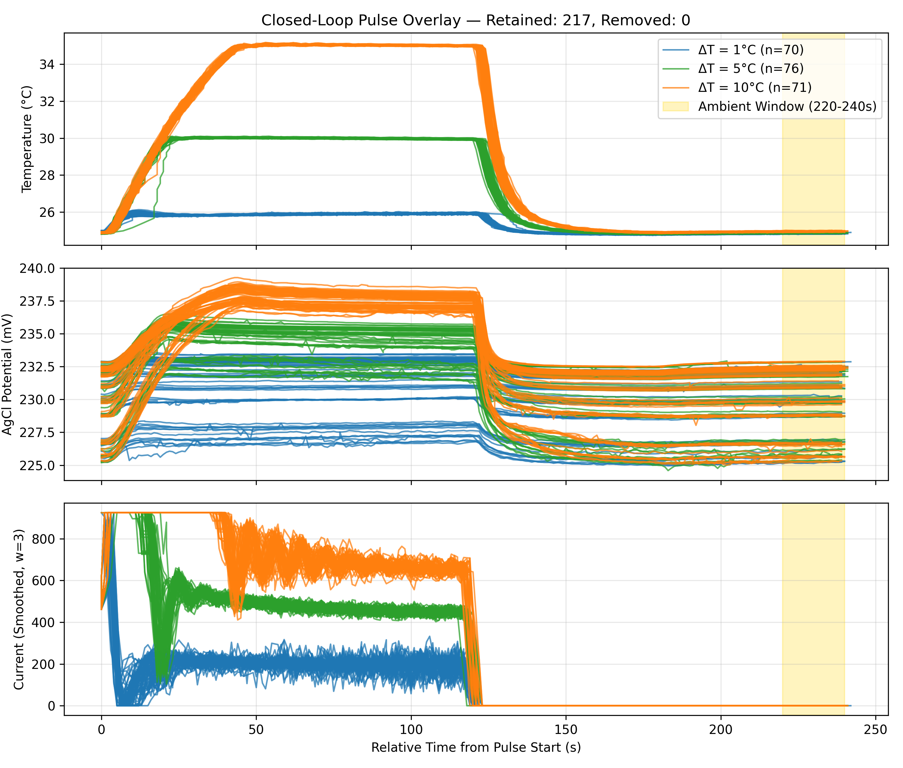
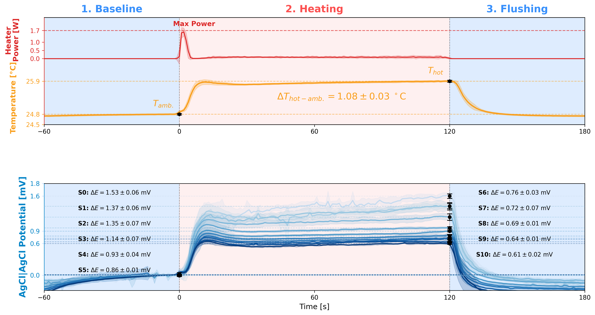
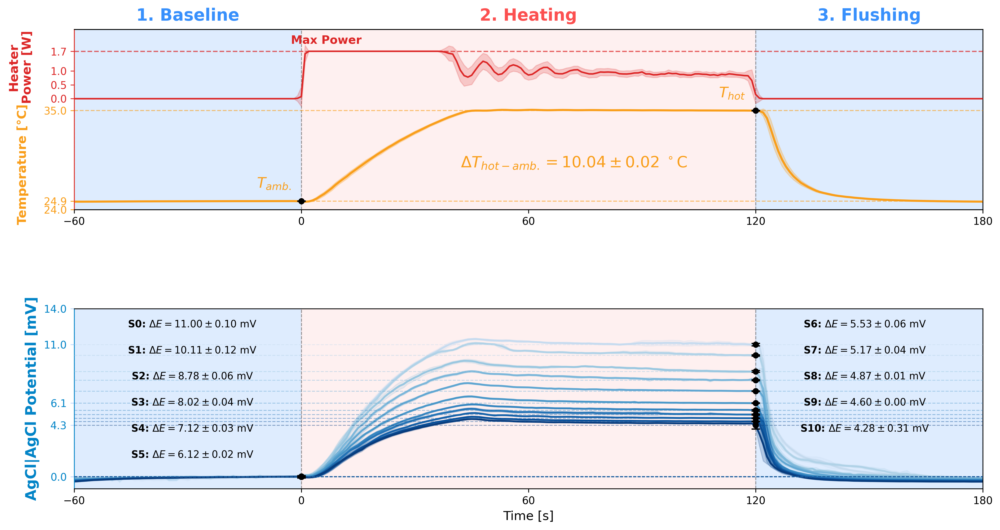

# Figure 3. Chloride Response

# Data Processing Steps

## Macro Selection and Parsing of Pulses (closedPulseParse.py)
Raw serial text data (closed_loop_titration.txt) is parsed into a pulse data structure and saved ina JSON file format. Macro-selection allows for some high level selection of the dataset.

### Time Series of Exp.

### Parsed Pulses

  
  

## Pulse Filtering (closedPulseSelect.py)

### Time Series of Exp.

### Filtered Pulses

### Calculating Delta (pulseCalc.py)

  
  
  

