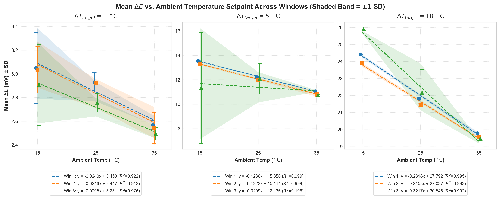
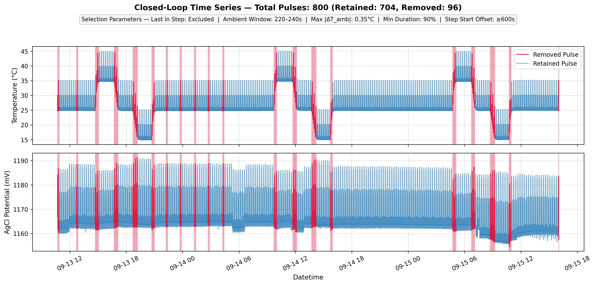
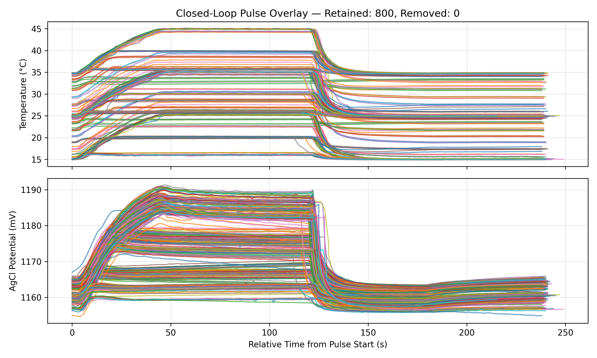
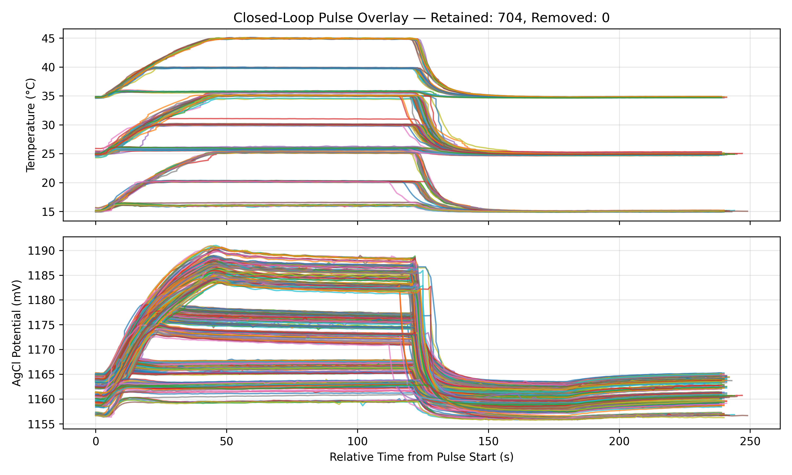
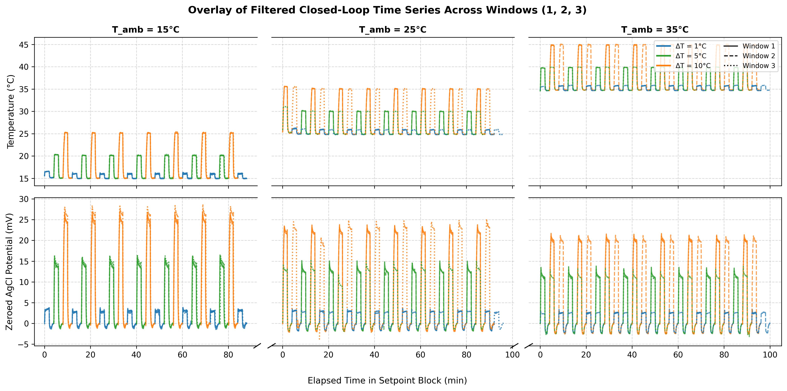
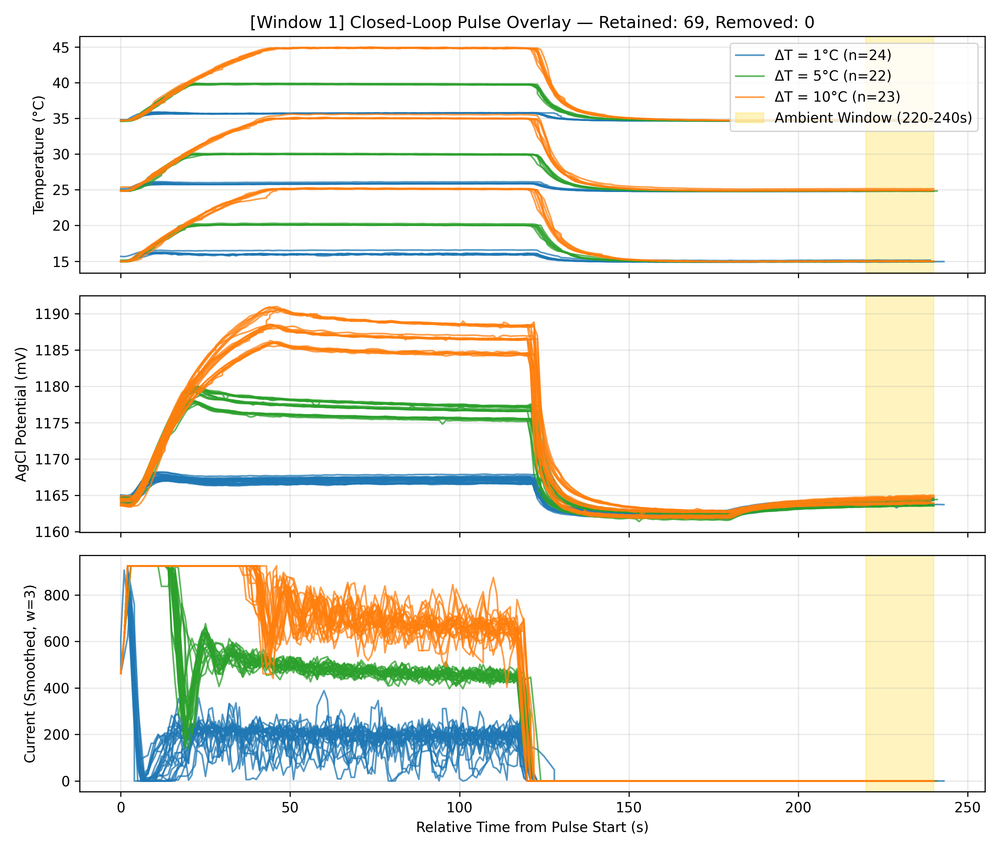
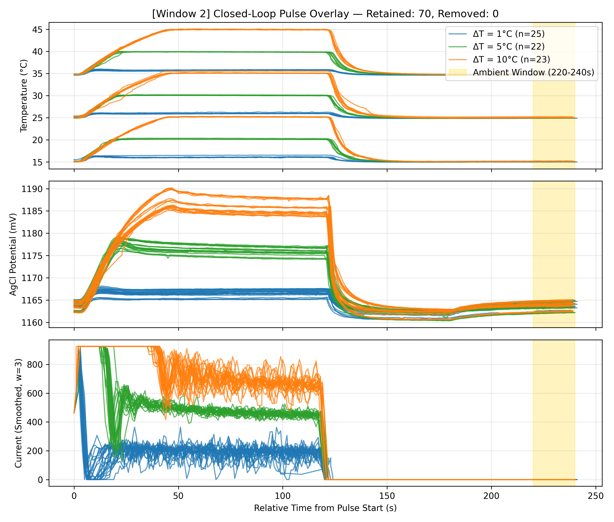
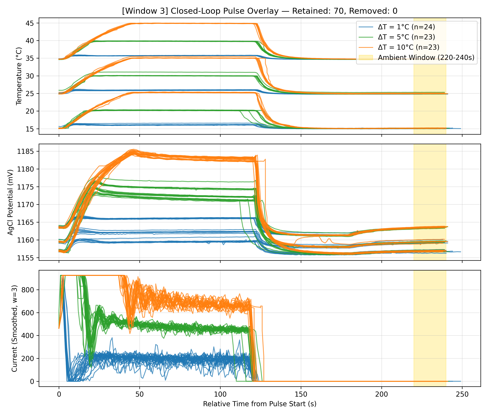

# Figure 4. Thermal Response Stability

## Macro Selection and Parsing of Pulses (pulseParse.py)
Raw serial text data (closed_loop_titration.txt) is parsed into a pulse data structure and saved ina JSON file format. Macro-selection allows for some high level selection of the dataset.

### Time Series of Exp.

### Parsed Pulses

  
  

## Pulse Filtering and Endpoiont Calculation (pulseSelect.py)

  
  
  

